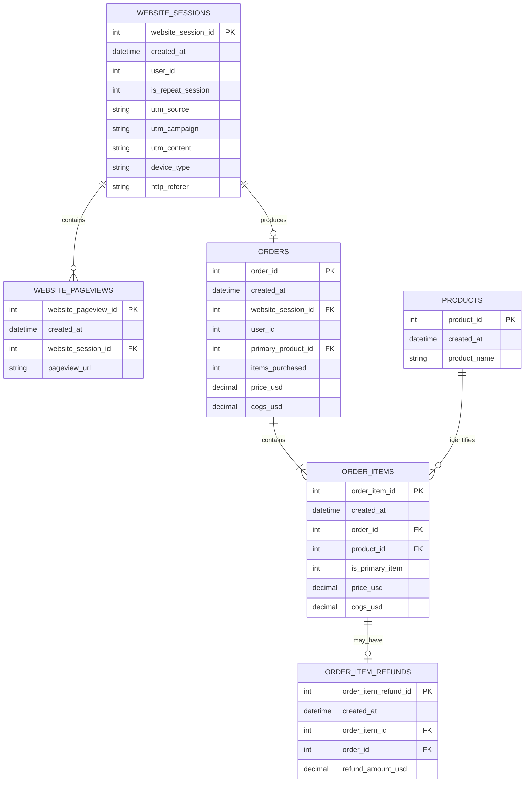
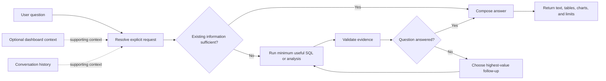
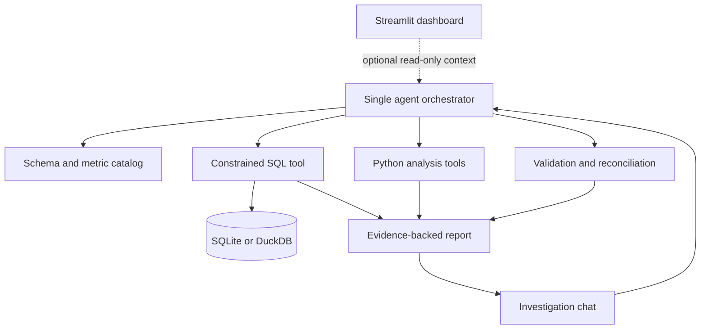

# Autonomous Marketing & Revenue Investigation Agent

> **Working project proposal / internal design document**  
> Status: Draft for discussion  
> Last updated: October 23, 2026  
> Intended use: A detailed project reference that can later be compressed into the required five-slide proposal deck.

## 1. Executive Summary

This project proposes a dashboard-connected AI agent for e-commerce managers. The dashboard shows the health of revenue, traffic, conversion, products, and refunds. A single conversational agent can answer questions independently, while optionally using the current dashboard state as supporting context. When a manager notices an unusual change, they can ask a question such as:

> Why did revenue decline last month?

The agent does more than translate that question into one SQL query. It adaptively decides how much analysis is necessary: a simple question may require no query or one aggregation, while a broad diagnostic question may require a multi-step investigation. It calculates the relevant metrics, compares segments and funnel stages, creates supporting visualizations, validates its findings, and produces a concise evidence-based report. It does not modify the dashboard or its filters.

The first version will use the **Maven Fuzzy Factory** e-commerce dataset. The product is positioned under **GTM Analytics / Revenue Intelligence**, with a deliberate focus on **marketing acquisition, website conversion, and revenue investigation**. It is not a Sales Intelligence product because the dataset contains no CRM pipeline, sales-representative activity, or opportunity data.

The central product promise is:

> Help an e-commerce manager move from “a KPI changed” to “here are the measurable drivers, the most likely next investigation, and the limits of what the available data can prove.”

The system will distinguish among:

- **Facts:** directly supported by query results.
- **Interpretations:** conclusions supported by several facts.
- **Hypotheses:** plausible explanations that require more evidence.
- **Unknowns:** questions the available data cannot answer.

This distinction is important because the dataset can often locate where a change happened, but it cannot always establish the real-world root cause.

---

## 2. Project Background and Motivation

Managers frequently monitor dashboards but still depend on analysts when a metric changes. A dashboard may show that revenue decreased, conversion weakened, or refunds increased, but it usually does not complete the investigation.

A typical workflow is:

1. A manager notices an unusual KPI movement.
2. The manager asks an analyst why it happened.
3. The analyst decomposes the metric and queries several related tables.
4. The analyst compares channels, devices, pages, products, and time periods.
5. The analyst summarizes what is known, what is uncertain, and what action to take next.

This process can take hours or days. It also contains repeatable reasoning patterns that an AI agent can support.

Existing analytics interfaces tend to solve only part of the problem:

- A conventional dashboard shows **what changed**, but rarely investigates why.
- A natural-language-to-SQL tool can answer a single question, but may not decide which follow-up question should be asked next.
- A general chatbot can produce fluent explanations, but may calculate metrics incorrectly or claim causes that are not supported by the data.

This project focuses on the gap between a dashboard signal and an analyst-quality investigation.

---

## 3. Problem Statement

### 3.1 User problem

E-commerce marketing and revenue managers need a faster way to investigate unexpected business performance changes without manually exploring many dashboards or waiting for a custom analyst report.

### 3.2 Technical problem

Build an AI system that can:

1. Convert a broad managerial question into a sequence of measurable sub-questions.
2. Select the correct metrics, dimensions, comparison periods, and tables.
3. Execute traceable SQL and deterministic calculations.
4. Decide which investigation branch is most informative.
5. Stop when it reaches either a supported conclusion or a data boundary.
6. Present evidence without overstating causality.

### 3.3 Product question

Can an AI agent reliably investigate revenue and conversion changes three to five steps beyond the initial dashboard signal, while clearly communicating what the dataset can and cannot prove?

---

## 4. Business Domain and Product Positioning

### 4.1 Recommended positioning

| Level | Positioning |
|---|---|
| Broad category | GTM Analytics / Revenue Intelligence |
| Primary focus | Marketing, Website Conversion, and Revenue Investigation |
| Main user | E-commerce marketing manager, growth manager, or revenue manager |
| Secondary user | Product manager responsible for the purchase funnel |
| Not positioned as | Sales Intelligence, CRM analytics, or a universal root-cause engine |

### 4.2 Why this is under GTM

The data follows the commercial path from acquisition to revenue:

```text
Marketing source
    → Website session
    → Page behavior
    → Checkout funnel
    → Order
    → Product and margin
    → Refund
```

This is a meaningful part of the go-to-market system because it connects marketing acquisition to customer behavior and realized revenue.

### 4.3 Why this is not a Sales product

The dataset does not contain:

- leads, accounts, or contacts;
- opportunities and pipeline stages;
- sales-representative activities;
- calls, emails, or meetings;
- win/loss reasons;
- forecast or quota data.

Calling the product a Sales Intelligence tool would therefore create expectations the data cannot support.

---

## 5. Target User and Core Workflow

### 5.1 Primary persona

An e-commerce marketing or revenue manager who:

- reviews weekly or monthly business performance;
- owns revenue, traffic, or conversion KPIs;
- understands the business but may not write SQL;
- needs timely explanations for performance changes;
- wants evidence that can be checked or shared with a team.

### 5.2 Core workflow

1. The manager opens the dashboard or goes directly to the agent.
2. If the manager is using the dashboard, the application makes the current page, filters, date range, selected KPI, and selected chart mark available as optional context.
3. The manager asks a free-form question. The question may explicitly define its own scope or may refer indirectly to something visible, such as “Why did this trend decline?”
4. The agent resolves the question using explicit user language first, conversation history second, and relevant dashboard context third.
5. The agent performs only the analysis required: it may answer from a metric definition, run one query, or conduct a multi-step investigation.
6. The agent queries the database as needed and evaluates whether the evidence is sufficient.
7. The agent generates a concise written explanation and any useful tables or temporary charts in the investigation workspace.
8. The result identifies measurable drivers, uncertainty, and recommended next steps without changing the dashboard state.
9. The manager can ask a follow-up question or inspect the supporting SQL and data.

### 5.3 Example output structure

Every investigation report should contain:

1. **Question and comparison window**
2. **Short answer**
3. **KPI decomposition**
4. **Main drivers ranked by contribution**
5. **Supporting charts and tables**
6. **Investigation path taken**
7. **Facts, interpretations, hypotheses, and unknowns**
8. **Recommended next actions**
9. **SQL and metric definitions used**

---

## 6. Dataset: Maven Fuzzy Factory

### 6.1 What the dataset represents

Maven Fuzzy Factory is a fictional U.S. e-commerce company used by Maven Analytics for business intelligence and SQL training. The company sells stuffed-animal products online.

The dataset is useful because it connects several stages of the customer journey rather than providing only aggregated KPIs.

### 6.2 Source and provenance

- Official dataset page: [Maven Analytics — Toy Store E-Commerce Database](https://mavenanalytics.io/data-playground/toy-store-e-commerce-database)
- Official guided experiment: [Maven Analytics — Landing Page A/B Test](https://mavenanalytics.io/guided-projects/landing-page-a-b-test)
- Public data copy used for local validation: [Maven Fuzzy Factory E-Commerce Business Intelligence repository](https://github.com/saraswathiTR/Maven-Fuzzy-Factory-E-Commerce-Business-Intelligence)

The data is public-domain educational data. It is realistic enough to demonstrate analytical workflows, but it is not evidence from a real operating company. Results should therefore be presented as a product and technical demonstration, not as real market research.

### 6.3 Size and time coverage

The six tables contain **1,735,068 rows** in total. The main session and pageview data runs from **March 19, 2012 through March 19, 2015**. Refund records extend into early April 2015.

| Table | Row count | Grain |
|---|---:|---|
| `website_sessions` | 472,871 | One website visit/session |
| `website_pageviews` | 1,188,124 | One page viewed during a session |
| `orders` | 32,313 | One completed order |
| `order_items` | 40,025 | One product line item in an order |
| `order_item_refunds` | 1,731 | One refunded order item |
| `products` | 4 | One product in the catalog |
| **Total** | **1,735,068** | — |

These counts were independently verified in the local copy of the data rather than copied only from a third-party description.

### 6.4 Data model



### 6.5 Table and attribute descriptions

#### `website_sessions`

Describes where a visit came from and what type of visit it was.

| Attribute | Meaning | Analytical use |
|---|---|---|
| `website_session_id` | Session identifier | Primary join key for visit-level analysis |
| `created_at` | Session start time | Trend and period comparison |
| `user_id` | Visitor identifier | New/repeat behavior and retention |
| `is_repeat_session` | Whether this user visited previously | New versus returning sessions |
| `utm_source` | Marketing source | Channel-level acquisition analysis |
| `utm_campaign` | Campaign category | Brand versus nonbrand analysis |
| `utm_content` | Ad or creative variant | Creative-level comparison |
| `device_type` | Desktop or mobile | Device performance comparison |
| `http_referer` | Referring URL | Direct, search, and referral context |

#### `website_pageviews`

Records the pages viewed within each session and their order over time.

| Attribute | Meaning | Analytical use |
|---|---|---|
| `website_pageview_id` | Pageview identifier | Ordering events and deduplication |
| `created_at` | Pageview time | Reconstructing user paths |
| `website_session_id` | Parent session | Joining behavior to acquisition and orders |
| `pageview_url` | Page visited | Landing-page, funnel, and drop-off analysis |

Typical paths include landing pages, product pages, cart, shipping, billing, and order-confirmation pages.

#### `orders`

Records completed transactions and order-level economics.

| Attribute | Meaning | Analytical use |
|---|---|---|
| `order_id` | Order identifier | Transaction key |
| `created_at` | Order time | Revenue trend |
| `website_session_id` | Converting session | Session-to-order conversion |
| `user_id` | Customer identifier | Customer behavior |
| `primary_product_id` | Main product purchased | Primary-product mix |
| `items_purchased` | Item count | Basket size and cross-sell |
| `price_usd` | Order revenue | Revenue and AOV |
| `cogs_usd` | Product cost | Gross margin |

#### `order_items`

Provides product-level detail within each order.

| Attribute | Meaning | Analytical use |
|---|---|---|
| `order_item_id` | Line-item identifier | Refund join key |
| `order_id` | Parent order | Basket analysis |
| `product_id` | Product purchased | Product performance |
| `is_primary_item` | Primary versus additional item | Cross-sell analysis |
| `price_usd` | Item revenue | Product revenue |
| `cogs_usd` | Item cost | Product margin |

#### `order_item_refunds`

Records item-level refunds but not the reason for the refund.

| Attribute | Meaning | Analytical use |
|---|---|---|
| `order_item_refund_id` | Refund identifier | Refund event key |
| `created_at` | Refund time | Refund trends and lag analysis |
| `order_item_id` | Refunded item | Product-level refund rate |
| `order_id` | Parent order | Order-level impact |
| `refund_amount_usd` | Refunded amount | Net revenue impact |

#### `products`

Contains the small product catalog and launch dates.

| Attribute | Meaning | Analytical use |
|---|---|---|
| `product_id` | Product identifier | Product joins |
| `created_at` | Product launch time | Launch and portfolio analysis |
| `product_name` | Product name | Human-readable reporting |

### 6.6 Verified baseline metrics

The locally loaded dataset produces the following approximate baseline metrics:

| Metric | Value |
|---|---:|
| Unique users | 394,318 |
| Repeat sessions | 78,553 |
| Orders | 32,313 |
| Sessions with an order | 32,313 |
| Overall session conversion rate | 6.83% |
| Gross revenue | $1,938,509.75 |
| Cost of goods sold | $722,370.25 |
| Gross margin | $1,216,139.50 |
| Gross margin rate | 62.7% |
| Refund amount | $85,338.69 |
| Average order value | $59.99 |
| Average pageviews per session | 2.51 |
| Multi-item orders | 7,712 |

These values are useful as data-loading checks. The final application should compute them from the database rather than hard-code them.

---

## 7. What the Data Can and Cannot Explain

### 7.1 Questions the data supports well

- Did revenue change because of order volume, average order value, or both?
- Did order volume change because traffic changed or conversion changed?
- Which source, campaign, creative, device, or landing page contributed most?
- At which stage of the website funnel did conversion weaken?
- How did a landing-page or billing-page variant perform relative to another?
- Which products generated revenue, gross margin, cross-sell, and refunds?
- How do new and repeat sessions behave differently?

### 7.2 Missing data and consequences

| Missing data | What cannot be concluded reliably |
|---|---|
| Advertising spend, impressions, and clicks | CAC, ROAS, cost efficiency, and true channel profitability |
| CRM and sales activities | Pipeline conversion, sales productivity, win/loss drivers, and forecast quality |
| Customer demographics | Performance by age, location, income, or customer profile |
| Customer feedback and refund reasons | Why customers abandoned or returned a product |
| Technical logs and error events | Whether a funnel decline was caused by a site bug or payment failure |
| Inventory and fulfillment status | Whether stockouts or delivery constraints caused lost sales |
| Prices, promotions, and coupons as events | Whether a change was caused by a promotion or price intervention |
| Competitor and market events | Whether external forces explain performance |
| Complete business-event log | Whether a specific operational decision caused a KPI shift |

### 7.3 Causality boundary

The agent may say:

> The revenue decline is concentrated in mobile nonbrand sessions, and the largest measurable deterioration occurred between product detail and cart.

It should not automatically say:

> A mobile website bug caused the revenue decline.

The first statement is supported by the data. The second requires technical logs, experiment evidence, or another external source.

An exception is a properly designed A/B test. When comparable users were randomly exposed to two variants during the same experiment, the agent can make a stronger causal statement, while still reporting uncertainty and experiment assumptions.

---

## 8. Proposed Product Experience

### 8.1 Product components

The product has two connected surfaces, but only one agent:

1. **Business Health Dashboard** — helps the manager notice and frame a problem and can provide optional context to the agent.
2. **Investigation Workspace** — provides one conversational entry point and shows the agent's evidence, findings, uncertainty, generated charts, and follow-up controls.

The dashboard is one possible entry point, not a dependency. The agent can answer questions unrelated to the current dashboard state. It can read relevant dashboard context but does not change dashboard filters, navigation, or charts. The agent is the primary innovation.

### 8.2 Dashboard design principles

- Use a small number of decision-relevant KPIs.
- Show comparisons and changes, not isolated totals.
- Make important segments explorable without overwhelming the user.
- Let every important signal launch an investigation.
- Keep metric definitions and comparison windows visible.
- Avoid presenting a detected anomaly as a proven cause.

### 8.3 Suggested dashboard sections

#### A. Executive overview

Top KPI cards:

- Gross revenue
- Net revenue after refunds
- Orders
- Sessions
- Session conversion rate
- Average order value
- Gross margin
- Refund rate

Each card should show:

- current value;
- absolute and percentage change;
- comparison period;
- small time-series sparkline;
- “Investigate” action.

#### B. Revenue driver view

Visual decomposition:

```text
Revenue = Sessions × Conversion Rate × Average Order Value
```

This section should answer whether a revenue movement came primarily from traffic, conversion, or order value.

Suggested visuals:

- revenue and orders over time;
- contribution waterfall;
- driver comparison table;
- major segment contributors.

#### C. Acquisition performance

Suggested breakdowns:

- UTM source;
- campaign;
- ad content;
- device;
- new versus repeat session;
- landing page.

Metrics:

- sessions;
- conversion rate;
- revenue per session;
- orders;
- gross margin per session.

Because cost data is missing, this section should not label revenue per session as ROAS.

#### D. Website funnel

Suggested stages:

```text
Landing
  → Products
  → Product detail
  → Cart
  → Shipping
  → Billing
  → Order confirmation
```

Show stage reach, step conversion, total conversion, and change from the comparison period. Allow filtering by device, channel, campaign, landing page, and date.

#### E. Product and refund performance

Metrics:

- product revenue;
- units sold;
- product gross margin;
- attachment/cross-sell rate;
- refund rate;
- refunded amount;
- refund trend.

#### F. Investigation panel

The manager can:

- type a question;
- launch a suggested question from any chart;
- ask a vague contextual question such as “Why did this decline?” without restating visible filters;
- ask an unrelated question whose explicit scope overrides the dashboard context;
- inspect the investigation steps when useful;
- review intermediate findings;
- open the generated SQL;
- ask a follow-up;
- export a short report.

Charts created by the agent belong to the current answer or investigation report. They do not replace or reconfigure the persistent dashboard.

---

## 9. Agent Concept and Investigation Workflow

### 9.1 Formal agent definition

> A single context-aware analytical agent that independently handles natural-language questions, optionally uses the current dashboard state to resolve missing context, and autonomously determines the required query and analysis depth.

The design uses one agent, one conversational entry point, and one adaptive investigation loop. It does not create separate “quick answer” and “deep investigation” agents. The amount of work emerges from the question and the available evidence:

- A definition question may require no SQL.
- A simple ranking question may require one aggregation query and one chart.
- A diagnostic question may require several queries, validations, decompositions, and charts.

“One shot” describes the user experience: the user should be able to ask once and receive a complete answer. It does not restrict the agent to one model call or one SQL query in the background.

### 9.2 Inputs and context precedence

The agent can receive three input sources:

1. **Explicit user request** — the metric, date, product, or comparison stated in the current question.
2. **Conversation history** — definitions and filters established earlier in the conversation.
3. **Optional dashboard context** — the current page, visible date range, active filters, selected KPI, selected chart, and selected data mark.

The precedence rule is:

```text
Explicit user request > conversation history > relevant dashboard context
```

Dashboard context is used only when it helps resolve the question. For example:

- “Why did this trend decline?” uses the visible metric, date range, and filters to resolve “this trend.”
- “Which product sold best in 2014?” uses the explicitly stated year even if the dashboard currently shows another period.
- “What does conversion rate mean?” can be answered from the metric definition without using dashboard filters.

If two inputs conflict and the difference would materially change the answer, the agent should state the interpretation it selected or ask one concise clarification. It should not silently combine incompatible scopes.

### 9.3 What makes this an agent

The system is not a single prompt followed by one fixed SQL query. It makes controlled choices within one adaptive loop:

1. Interpret the user's explicit request.
2. Use conversation or dashboard context only where it resolves an omitted reference.
3. Identify the target metric, time range, comparison, and filters.
4. Determine whether existing context or a metric definition is sufficient.
5. If not, select and execute the minimum useful query or analysis tool.
6. Evaluate whether the evidence answers the question.
7. If evidence is insufficient, choose the highest-value follow-up query.
8. Validate totals, joins, denominators, sample sizes, and time windows.
9. Stop when the evidence is sufficient or when the dataset reaches its limit.
10. Generate one traceable answer with text and, when useful, tables or temporary charts.

### 9.4 Adaptive investigation loop



The loop never sends actions back to the dashboard. Dashboard context flows into the agent; answers and generated evidence flow into the investigation workspace.

### 9.5 Division of responsibility

| Component | Responsibility |
|---|---|
| LLM | Interpret question, plan investigation, select tools, summarize evidence |
| Metric layer | Define revenue, conversion, AOV, margin, refund rate, and funnel metrics |
| SQL engine | Join and aggregate structured data |
| Python analysis | Decomposition, contribution analysis, statistics, and chart preparation |
| Validation layer | Check row counts, totals, denominators, nulls, and reconciliation |
| Visualization layer | Produce manager-readable charts |
| Evidence store | Preserve queries, results, assumptions, and investigation steps |
| Context resolver | Apply input precedence and determine whether dashboard state is relevant |

### 9.6 Guardrails

- Read-only database access.
- Allowlisted tables, dimensions, and metrics.
- Query timeout and result-size limits.
- Explicit date and comparison windows.
- Metric definitions controlled in code, not invented by the LLM.
- Reconciliation of segment totals to the parent total.
- SQL and calculation trace shown in the report.
- Explicit user constraints override dashboard filters.
- Dashboard state is read-only from the agent's perspective.
- The final answer states any dashboard context that materially affected the scope.
- Causal language allowed only when experimental evidence supports it.
- “Insufficient data” treated as a valid result.

### 9.7 Stopping rules

The agent should stop when one of the following is true:

1. One or more measured drivers explain most of the observed change.
2. Additional segmentation produces very small samples or unstable conclusions.
3. The next question requires data that does not exist.
4. The result is a hypothesis that needs an experiment, technical log, or qualitative evidence.
5. The requested metric is not identifiable from the available tables.

---

## 10. Two Example Investigation Scenarios

These scenarios demonstrate the two context behaviors the product must support. The first uses dashboard state to resolve a vague question. The second combines dashboard context with an explicit historical reference from the user. Both use the same agent and adaptive investigation loop.

### Scenario 1: A vague question about a visible revenue decline

#### Dashboard context

The manager is viewing the Revenue Overview for June 2014 compared with May 2014. The chart shows a decline, but the user does not restate the metric, dates, or active filters.

#### Manager question

> Why did revenue decline last month?

#### How context is resolved

- “Revenue” is explicit in the question.
- “Last month” is resolved from the dashboard's June 2014 comparison state.
- Any visible dashboard filters are treated as the initial scope unless the user states a different one.
- The dashboard remains unchanged throughout the investigation.

#### Investigation depth

**Step 1 — Confirm the visible change**

- Recalculate revenue for June and May 2014 under the inherited filters.
- Check whether the period is complete and whether the dashboard value reconciles to the database.

**Step 2 — Decompose revenue**

```text
Revenue = Sessions × Conversion Rate × Average Order Value
```

- Determine whether the main driver was traffic, conversion, or order value.

**Step 3 — Rank segment contributions**

- Break down the largest driver by source, campaign, ad content, device, new/repeat session, and landing page.
- Rank segments by contribution to the total decline rather than percentage change alone.

**Step 4 — Follow the most informative branch**

- If conversion is the main driver, compare the purchase funnel for the most affected segments.
- If traffic is the main driver, identify the acquisition segments responsible.
- If AOV is the main driver, compare product mix and items per order.

**Step 5 — Check secondary effects and stop appropriately**

- Check product mix, gross margin, and refunds when they are relevant.
- Stop when the main measurable drivers are explained or the next question requires missing evidence.

#### Expected response

The agent returns one concise answer containing:

- the magnitude of the decline;
- the revenue decomposition;
- the segments and funnel stages that contributed most;
- temporary charts created for this investigation;
- facts, hypotheses, and missing evidence;
- the most useful next action.

#### Demonstrated dataset result

In the local data, revenue decreased by roughly 10% from May to June 2014. Sessions declined by only about 1.9%, conversion declined by about 7.7%, and AOV was relatively stable. Most of the revenue decrease was concentrated in `gsearch` nonbrand traffic across desktop and mobile. The data can trace the deterioration through landing pages and funnel transitions, but it cannot prove whether the underlying cause was an advertising change, website problem, or external event.

---

### Scenario 2: The user remembers the metric looking different

#### Dashboard context

The manager is viewing the Product & Refunds page for the Original Mr. Fuzzy product during August and September 2014. The selected chart is refund rate, which appears unusually high.

#### Manager question

> I remember this product's refund rate being much lower earlier that year. Why does it look so different now?

#### How context is resolved

- “This product” resolves to Original Mr. Fuzzy from the dashboard selection.
- “It” resolves to refund rate because that is the selected metric.
- “Earlier that year” is interpreted as the preceding months of 2014 and is stated explicitly in the answer.
- The user's words define the comparison question; the dashboard supplies only the omitted product, metric, and current period.

#### Investigation depth

**Step 1 — Verify the user's memory**

- Calculate monthly refund rate, refunded amount, units sold, and product revenue across 2014.
- Confirm whether the current period is materially different from earlier months.

**Step 2 — Separate sales volume from refund propensity**

- Determine whether refund dollars rose because more units were sold, because the refund rate increased, or both.

**Step 3 — Locate the observable concentration**

- Compare primary versus cross-sell items, order cohorts, acquisition sources, devices, and relevant time windows.
- Display sample sizes so small segments are not overinterpreted.

**Step 4 — Quantify the commercial impact**

- Estimate refunded revenue and the effect on net revenue and product margin.

**Step 5 — Identify the data boundary**

- State that refund-reason codes, customer feedback, product-quality records, and fulfillment data are absent.
- Recommend the next evidence required instead of inventing an operational cause.

#### Expected response

The agent returns:

- whether the remembered difference is supported by the data;
- the historical trend and current-period comparison;
- whether volume or refund rate drove the change;
- the financial impact;
- the strongest observable concentration;
- a clear statement of what the dataset cannot explain.

#### Demonstrated dataset result

The Original Mr. Fuzzy refund rate was about 4.4% in July 2014, rose to about 13.8% in August and 13.3% in September, and fell to about 2.5% in October. The dataset supports the user's observation and can quantify and localize the anomaly, but it does not contain the operational reason for the refunds.

---

## 11. Proposed Technical Architecture

### 11.1 MVP stack

| Layer | Recommended technology | Purpose |
|---|---|---|
| Data storage | SQLite for current validated copy; DuckDB is an acceptable alternative | Reproducible local analytical database |
| Data transformation | SQL and Python | Metric computation and reusable analysis |
| Application | Streamlit | Fast implementation of dashboard and investigation workspace |
| Visualization | Plotly | Interactive business charts |
| Agent orchestration | OpenAI API with structured tool calls | Planning and controlled analysis loop |
| Schemas and validation | Pydantic | Typed plans, tool inputs, and report outputs |
| Statistical analysis | Python with pandas and SciPy/statsmodels as needed | Contribution analysis and experiment evaluation |
| Testing | pytest plus golden-query fixtures | Metric, SQL, and investigation validation |

React may produce a more polished interface, but Streamlit is the recommended first implementation because the core research question is the quality of the investigation, not custom front-end engineering.

### 11.2 High-level architecture



### 11.3 Suggested analytical tools

The agent should call a small number of explicit tools rather than receive unrestricted code execution.

- `get_metric_definition(metric_name)`
- `inspect_schema(table_name)`
- `run_readonly_query(sql, parameters)`
- `decompose_revenue(current_period, comparison_period, filters)`
- `build_funnel(period, filters)`
- `rank_segment_contributions(metric, dimension, periods, filters)`
- `evaluate_experiment(experiment_definition)`
- `analyze_refunds(periods, filters)`
- `create_chart(chart_spec, data_reference)`
- `validate_investigation(investigation_id)`

The exact interfaces can be refined during implementation. The important design decision is that the LLM chooses among controlled analytical operations, while deterministic code performs calculations.

### 11.4 Why RAG is not required in version 1

The core evidence is structured and relational. SQL is the appropriate retrieval mechanism. Converting raw transaction tables into text chunks and vector-searching them would reduce precision.

RAG could become useful later for unstructured context such as:

- metric and business glossaries;
- experiment briefs;
- product launch notes;
- marketing calendars;
- customer feedback;
- technical incident reports;
- previous investigation reports.

Therefore:

- **Version 1:** schema-aware tools, SQL, Python, validation, and evidence tracing.
- **Possible extension:** RAG over business context that is not represented in the relational data.

---

## 12. Evaluation Plan

The product should be evaluated as an analytical system, not only as a user-interface demo.

### 12.1 End-to-end investigation scenarios

Use the two scenarios above as fixed end-to-end evaluations. For each scenario, define:

- the manager question;
- date and comparison windows;
- expected investigation path;
- expected SQL results;
- correct main drivers;
- claims that are allowed;
- claims that must be rejected;
- required charts;
- acceptable final recommendation.

### 12.2 Evaluation dimensions

| Dimension | Success criterion |
|---|---|
| Numerical correctness | Key metrics match validated SQL fixtures |
| Investigation depth | Agent follows at least three meaningful analytical steps when supported |
| Driver prioritization | Agent identifies contributors by business impact, not only percentage change |
| Traceability | Every factual claim maps to a query result or computed output |
| Causal discipline | Agent does not convert correlation into unsupported causation |
| Data-boundary awareness | Agent explicitly identifies missing evidence and can refuse unanswerable questions |
| Reproducibility | Same fixed question and data snapshot produce materially consistent conclusions |
| User usefulness | A manager can understand the result and identify a reasonable next action |
| Responsiveness | Standard investigation completes within a practical demo time |

### 12.3 Validation tests

- Unit tests for metric definitions.
- Join-integrity and row-count tests.
- Tests for incomplete date windows.
- Segment reconciliation tests.
- Funnel-stage ordering tests.
- Experiment exposure tests.
- Prompt-injection resistance for user-entered questions and database text.
- Tests that force an “insufficient data” response.
- Regression tests for both end-to-end investigation scenarios.
- Smaller targeted tests for channel, funnel, experiment, product, and refund analysis tools.

### 12.4 Human evaluation

A small rubric can ask whether the final answer:

1. directly answers the manager's question;
2. gives enough evidence to trust the result;
3. distinguishes measured drivers from hypotheses;
4. avoids unnecessary technical detail;
5. recommends a useful next step.

---

## 13. Scope and Non-Goals

### 13.1 In scope for the first version

- A reproducible local database built from the six Maven tables.
- A dashboard showing core revenue, acquisition, funnel, product, and refund metrics.
- Manager-initiated investigations.
- Revenue decomposition.
- Marketing-segment comparison.
- Website-funnel analysis.
- A/B test analysis for defined experiments.
- Product and refund analysis.
- Evidence-backed reports with SQL traceability.
- Two complete end-to-end investigation scenarios plus targeted analytical test cases.
- Explicit handling of unsupported questions.

### 13.2 Out of scope for the first version

- Real-time data ingestion.
- Automatic modification of campaigns or the website.
- Sales pipeline or CRM analysis.
- Accurate CAC and ROAS without advertising-cost data.
- Universal business root-cause analysis.
- RAG over raw transactional tables.
- Forecasting as a primary feature.
- Fully autonomous anomaly detection and notifications.
- Production authentication, permissions, and multi-tenant deployment.
- A custom React front end unless time remains after the analytical workflow works reliably.

### 13.3 Possible extensions

- Automatically detect important KPI anomalies.
- Add a business-event calendar.
- Add advertising spend and impression data.
- Add customer feedback and refund reasons.
- Add technical incident logs.
- Add RAG over unstructured business context.
- Add scheduled investigation reports.
- Connect to a real warehouse with governance and access controls.

---

## 14. Risks and Mitigations

| Risk | Why it matters | Mitigation |
|---|---|---|
| Dataset is fictional | Limits claims about real business impact | Present project as a technical and product prototype |
| Agent hallucinates causes | Could mislead a manager | Enforce evidence categories and causal-language checks |
| Text-to-SQL errors | Incorrect joins or denominators can produce convincing false results | Use a metric layer, query templates, validation, and gold tests |
| Investigation is hard-coded | Demo may not generalize beyond the two stories | Test follow-up questions and analytical tools outside the two primary narratives |
| Scope becomes too broad | Full GTM analytics is not supported by the data or schedule | Keep MVP focused on marketing, conversion, and revenue |
| Dashboard consumes project time | UI polish could displace the core agent work | Build a compact Streamlit interface first |
| Small subgroup sizes | Large percentage changes may be meaningless | Display sample size and uncertainty; apply minimum thresholds |
| Experiment assumptions are unclear | Correlation could be mislabeled as causation | Encode experiment windows and exposure rules explicitly |
| Missing data prevents root-cause proof | Agent may reach a useful boundary rather than a final cause | Treat missing evidence and next-data recommendations as first-class outputs |

---

## 15. Proposed Milestones

### Milestone 1 — Data and metric foundation

- Finalize the local database build.
- Document schema and joins.
- Implement and test the canonical metrics.
- Validate the two end-to-end scenarios manually with SQL.

**Evidence of completion:** reproducible load script, data-quality report, and validated metric fixtures.

### Milestone 2 — Deterministic investigation functions

- Build reusable revenue decomposition, funnel, channel, experiment, and refund analyses.
- Produce structured result objects and charts without an LLM.

**Evidence of completion:** both end-to-end scenarios can be completed by deterministic functions, and the underlying analytical tools pass targeted tests.

### Milestone 3 — Agent orchestration

- Add explicit-question, conversation-history, and optional-dashboard-context resolution.
- Add one adaptive investigation loop whose depth is determined by evidence sufficiency.
- Connect controlled analysis tools.
- Add validation and stopping rules.
- Produce structured evidence-backed reports.

**Evidence of completion:** the agent completes multi-step investigations and appropriately stops at data boundaries.

### Milestone 4 — Dashboard and user experience

- Build the executive KPI view.
- Add acquisition, funnel, and product/refund views.
- Connect chart signals to the investigation workspace.
- Add SQL and evidence inspection.

**Evidence of completion:** a user can move from a KPI signal to a complete investigation in one application.

### Milestone 5 — Evaluation and presentation

- Run both end-to-end investigations and the targeted analytical tests.
- Record correctness, failure cases, latency, and limitations.
- Refine the demo narrative.
- Compress this document into the course proposal and final presentation materials.

**Evidence of completion:** reproducible evaluation report and a stable end-to-end demonstration.

---

## 16. Definition of Success

The first version is successful if:

1. It completes both defined investigation scenarios with validated calculations.
2. It can investigate at least three meaningful levels deep when the data supports it.
3. It produces charts and written findings that a manager can understand.
4. Every factual claim is traceable to a query or deterministic calculation.
5. It identifies the main contributors to a KPI movement rather than listing every segment.
6. It distinguishes facts, interpretations, hypotheses, and unknowns.
7. It refuses to claim causes that require missing data.
8. It demonstrates more analytical value than a static dashboard or one-shot text-to-SQL interface.
9. Another person can reproduce the application and the main findings from the repository.

---

## 17. Key Design Decisions Made So Far

| Decision | Current choice | Reason |
|---|---|---|
| Business category | GTM Analytics / Revenue Intelligence | Connects acquisition, conversion, and revenue |
| Primary focus | Marketing, website conversion, and revenue | Best match for the available data |
| Primary user | E-commerce marketing or revenue manager | Owns the relevant decisions and KPIs |
| Agent count | One | Avoids artificial separation between simple and complex questions |
| Core interaction | One conversational entry point with adaptive investigation depth | Keeps the user experience consistent while allowing variable analytical depth |
| Dashboard relationship | Optional, read-only contextual input | Resolves vague references without making the agent dependent on or able to modify the dashboard |
| Input precedence | User request, then conversation history, then relevant dashboard context | Explicit user intent must override incidental UI state |
| Main innovation | Multi-step, evidence-backed investigation agent | Goes beyond dashboarding and one-shot SQL |
| Data access | SQL over structured relational data | Most precise fit for the evidence |
| Calculation | Deterministic SQL/Python | Reduces hallucinated arithmetic |
| RAG in MVP | No | The primary evidence is structured, not textual |
| Front end | Streamlit first | Preserves time for agent and evaluation quality |
| Causal claims | Restricted to supported experimental settings | Prevents overclaiming |

---

## 18. Open Questions

These questions should be resolved before or during implementation:

1. Should the dashboard default to weekly or monthly comparison periods?
2. Should the agent show detailed investigation steps during execution or only in the completed answer?
3. Which metrics should trigger suggested questions on the dashboard?
4. How much SQL and intermediate evidence should be visible by default?
5. What minimum segment size should prevent unstable conclusions?
6. Which exact dashboard state fields should be included in the context packet?
7. Which statistical method and significance threshold should be used for the A/B tests?
8. Should net revenue subtract refunds based on purchase cohort or refund event date?
9. What response time is acceptable for a live presentation?
10. Which of the two scenarios should serve as the primary five-minute demo narrative?

---

## 19. Five-Slide Proposal Mapping

This internal document can later be condensed into the course proposal deck as follows:

| Slide | Main content from this document |
|---|---|
| 1. Problem and audience | Sections 2–5 |
| 2. Proposed solution | Sections 1, 8, and 9 |
| 3. Data and technical approach | Sections 6, 7, and 11 |
| 4. Scope, risks, and evaluation | Sections 12–14 |
| 5. Plan and success criteria | Sections 15–16 |

The slide deck should communicate the product clearly in about five minutes. This longer proposal remains the working reference for data, architecture, investigation depth, limitations, and evaluation.

---

## 20. Current One-Sentence Pitch

> A single context-aware AI agent that helps e-commerce managers answer questions and investigate changes in marketing, website conversion, and revenue by optionally using dashboard context, adaptively querying connected data, and clearly separating evidence from hypotheses and unknowns.

